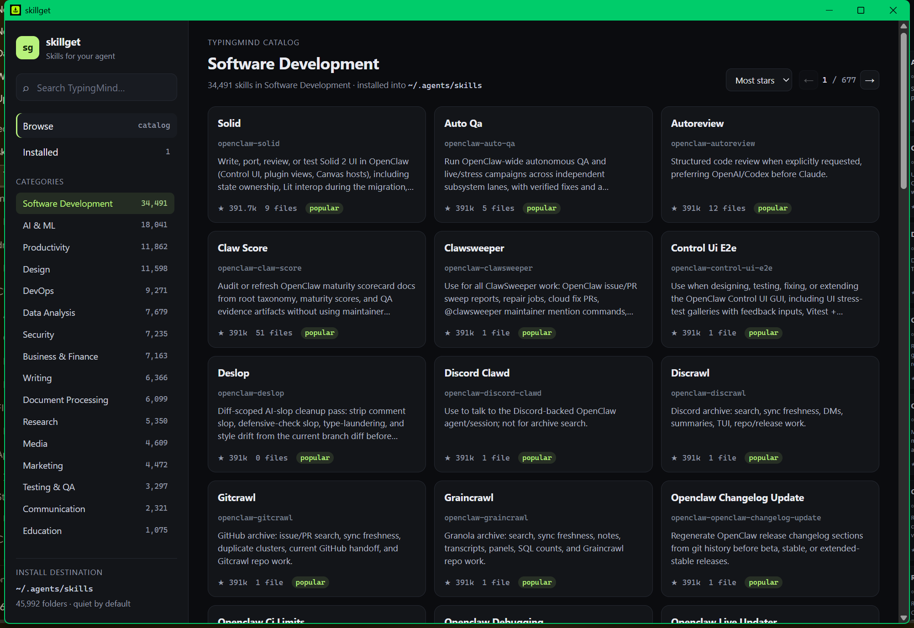

# skillget by Don PELY

Harvest open-source AI agent skills from the
[TypingMind Skills directory](https://www.typingmind.com/skills) and install them as
local, ready-to-use skill folders (`SKILL.md` + supporting files) under
`~/.agents/skills/`.

The default target is the **DevOps** category (**9,271 skills**), but any category or
any site search works. The crawler is resumable, keeps a per-skill manifest, never
overwrites a skill it did not install, and can stage the bulk outside the live skill
root so a long crawl does not flood an agent's context window.

Two modes:

- **Category harvest** — mirror an entire category (`--category`).
- **Search harvest** — crawl only the hits for a query (`--q`, or a pasted search URL).

## Desktop app (Windows)

[`skillget-desktop/`](skillget-desktop/) is a Tauri 2 app over the same engine: browse the
16 categories, search the catalog, read a skill's `SKILL.md`, and install it into
`~/.agents/skills` with quiet mode and the same never-overwrite rules.



Download the installer or portable zip from the
[latest release](https://github.com/yourbossdonpely/skillget/releases/latest); build it
with `cd skillget-desktop && npm install && npm run app:build`. See
[`skillget-desktop/README.md`](skillget-desktop/README.md) for details.

> **Status:** the local library holds **45,856 manifest entries, all `ok`**, including
the full DevOps and `software-development` harvests and a 619-skill animation/video
harvest. See [Run status](#run-status).

## Why this exists

The TypingMind directory is a UI over thousands of community `SKILL.md` packages.
Clicking **View** on every card and copying files by hand does not scale. `skillget`
uses the site's own structured data and the public GitHub repositories behind each
skill to build a reproducible local mirror in one command.

## Quick start

```powershell
cd C:\dev\appbuilddev\skillget
python -m pip install -r requirements.txt

# 1. Build the catalog (182 pages, 9,271 unique skills)
python tools/skillget.py catalog

# 2. Install everything into ~/.agents/skills; --quiet marks these installs as
#    non-autoinvoking (still loadable by ID) so they stay out of the injected list
python tools/skillget.py crawl --quiet

# 3. Build the discovery index
python tools/index.py
```

A targeted search instead of a whole category (each query gets its own catalog file):

```powershell
python tools/skillget.py catalog --category media --q "blender animation"
python tools/skillget.py crawl   --category media --q "blender animation"
```

A search URL pasted from the site works as-is; the `category` and `q` parameters are
both read from it:

```powershell
python tools/skillget.py crawl --category "https://www.typingmind.com/skills?category=media&q=capcut"
```

If an agent session is live while you crawl, use the staging workflow below instead;
it avoids thousands of filesystem events in the scanned skill root.

Resume an interrupted run (keep the same flags). If the previous run was killed or
crashed mid-install, reconcile first so finished-but-unmoved skills are recovered and
the manifest matches disk:

```powershell
python tools/reconcile.py
python tools/skillget.py crawl --quiet
```

`crawl` holds `data/.crawl.lock` and refuses to start a second concurrent crawl against
the same destination. Concurrency is a correctness feature here: two crawlers renaming
into the same folders race and corrupt the manifest. Run one crawl at a time.

Check progress / verify:

```powershell
python tools/skillget.py status
python tools/skillget.py verify
python tools/skillget.py verify --include-local   # also audit non-manifest (hub) skills
python tools/report.py
```

## Staging for very large installs

An agent harness may scan every `SKILL.md` under `~/.agents/skills` at session start.
Loading 9,000+ descriptions can exceed a context window. For a large crawl, install to
a staging directory outside the scanned roots, then merge once at the end:

```powershell
$stage = "$env:TEMP\opencode\skillget-staging"
python tools/skillget.py crawl --dest $stage --manifest data\manifest-staging.json --quiet

# when the crawl is complete:
python tools/merge.py --source $stage
```

`merge.py` moves each skill into `~/.agents/skills`, merges the manifests, and gives a
`-tm` suffix to any colliding folder that was not created by skillget.

## Thousands of skills without a giant prompt

OpenCode (and similar harnesses) inject the name and description of every available
skill into the system prompt. A 9,271-skill library would consume more context than
most models have. skillget therefore supports a **quiet** install: each `SKILL.md` it
installs with `crawl --quiet` gets one extra frontmatter key,

```yaml
metadata:
  opencode/autoinvoke: false
```

The skill stays installed and can still be loaded by ID with the `skill` tool; it is
simply omitted from the auto-injected list. The edit is line-based and preserves the
rest of the original YAML.

The flag is a property of skillget's own quiet installs, not of the skill root. Skills
installed by other tooling under the same root (the hub/bundled skills) are configured
by that tooling and may carry their own `autoinvoke` settings; skillget folders from an
older, non-quiet crawl keep their original frontmatter, and so do skill files whose
frontmatter the quiet pass could not edit. `tools/quiet.py --root <dir>` adds the flag
to whichever of those folders you point it at.

```powershell
# after the crawl, before or after merging:
python tools/quiet.py --root "$env:TEMP\opencode\skillget-staging"
python tools/merge.py --source "$env:TEMP\opencode\skillget-staging"

# build a greppable index next to the skill root:
python tools/index.py --dest "$env:USERPROFILE\.agents\skills"
```

`index.py` writes `~/.agents/skills-index.md` (one table row per skill) and
`~/.agents/skills-index.json` (full metadata). Both live outside the scanned skill
root, so they do not become skills themselves.

The index covers everything loadable under the skill root, not just what `skillget`
installed. After the manifest pass it walks the root for `SKILL.md` files that the
manifest does not record — hub/bundled skills, hand-placed folders, and skills nested
in category directories — and adds a row for each, using the folder's path relative to
the root as its ID (so a nested skill is `apple/apple-notes`, not `apple-notes`). Each
JSON record carries an `origin` field: `skillget` for manifest-owned installs, `local`
for the rest. Hidden directories and `node_modules` are skipped; skills without YAML
frontmatter get their name and description from the first heading and prose line.

To make a subset auto-invokable again, remove the `opencode/autoinvoke` line from
those quiet installs' frontmatter. Keep the subset small (tens, not thousands).

## Search harvests (`--q`)

`--q` runs the site's own search endpoint instead of paging a whole category. Results
are cached per query in `data/catalog-<category>-<slugified-query>.json`, so a search
never clobbers the category catalog (`data/catalog.json`) and re-running the same
query is free. `crawl` reuses the cached search, then fetches details and installs
exactly like a category crawl — same manifest, same dedupe, same `ok`-state skipping.

```powershell
python tools/skillget.py catalog --category media --q "motion graphics"   # count the hits
python tools/skillget.py crawl   --category media --q "motion graphics"   # install them
python tools/skillget.py crawl   --category media --q "ffmpeg" --workers 8
```

Search hits overlap across queries (a Blender skill also matches "animation"), so
crawling many queries in sequence is safe: the manifest keys on slug and already-`ok`
entries are skipped. That is how the animation/video set below was built — 23 queries,
**619 unique skills, 0 failures**:

| query | installed | query | installed |
| --- | ---: | --- | ---: |
| `ffmpeg` | 154 | `storyboard` | 62 |
| `animation` | 152 | `motion graphics` | 49 |
| `video generation` | 73 | `youtube shorts` | 32 |
| `video editing` | 29 | `davinci resolve` | 22 |
| `vfx` | 20 | `blender` | 17 |
| `image to video` | 11 | `capcut` | 10 |
| `kinetic typography` | 10 | `vertical video` | 10 |
| `sound design` | 9 | `compositing` | 8 |
| `3d animation` | 6 | `text to video` | 5 |
| `character animation` | 4 | `lip sync` | 4 |
| `blender render` | 2 | `2d animation` | 2 |
| `stop motion` | 1 | | |

Visible ones from that batch worth knowing about: `nocodehack-make-short` (9:16 short
with bean characters in a painted Blender world), `varghq-blender-code-film` and
`varghq-code-path-traced-film` (films written entirely in Python, the second writes its
own path tracer), `el4cteo-blender-video-editing` / `-rendering` / `-lighting-lookdev`
(Blender 5.3 specific), `mromidev-blender-film`, `mromidev-blender-forest`,
`nicceasy-3d-product`, `angrypenguinpng-blender-claymation` (stop-motion claymation),
`renezander030-capcut-edit` (reads/writes CapCut project files, not GUI clicking),
`social-media-skills-capcut`, `mrpaidsocial-capcut-export`, `codepawl-edit-video`.

### Reporting a search batch

```powershell
python tools/report_media.py      # per-query installed/missing/hit counts for data/catalog-media-*.json
python tools/spotcheck_media.py   # prints each hit's folder, size, file count and description
```

`report_media.py` also registers the authoring skill (below) in the manifest, and
verifies every installed folder really contains a `SKILL.md`.

## Installing the authoring skill (`skill-creator`)

`skillget` harvests third-party skills; the **authoring** skill — Anthropic's
`skill-creator`, the one that drafts, tests and refines skills — is not in the
TypingMind catalog, so it is fetched from its upstream repository instead:

```powershell
python tools/fetch_authoring_skill.py
```

It downloads all 18 files of
[`anthropics/skills/skills/skill-creator`](https://github.com/anthropics/skills/tree/main/skills/skill-creator)
(`SKILL.md`, `scripts/`, `agents/`, `references/`, `eval-viewer/`, LICENSE) into
`~/.agents/skills/anthropic-skill-creator/` and writes a `.skillget.json` provenance
record. The manifest slug is `anthropic-skill-creator`, so the skill loads by ID. The
script is idempotent: re-running it refreshes the files in place.

## How it works

1. **Catalog.** The TypingMind skills page is a Next.js app. Its page-data endpoint
   (`/_next/data/<buildId>/skills.json?category=devops&page=N&sort=stars`) returns 51
   skills per page as JSON. `skillget` walks every page and deduplicates by slug.
   `sort=stars` is used because it is stable across page requests. The same endpoint
   accepts `q=`; `tm_catalog.fetch_query()` pages that result set until `totalCount`
   is reached, which is what `--q` uses.
2. **Large categories (200-page cap).** The list endpoint clamps every ordering at
   page 200 (~10,200 rows), so a category bigger than that cannot be enumerated by
   paging alone (e.g. `software-development` reports 34,491). `skillget` detects this
   and partitions the category by the category-scoped `author` filter: each author has
   few skills, so iterating the site's `authorOptions` covers the full category. This
   is controlled by `--split-by auto|author|none` (default `auto`).
2. **Detail.** Each skill has a JSON detail endpoint
   (`/_next/data/<buildId>/skills/<slug>.json`) containing the full `bodyMarkdown`,
   license, compatibility, `allowedTools`, `sourceURL`, `owner`, `repo`, `path`,
   `defaultBranch`, and a list of supporting `resources`.
3. **Canonical file.** `SKILL.md` is fetched from
   `raw.githubusercontent.com/<owner>/<repo>/<branch>/<path>/SKILL.md` so the original
   YAML frontmatter is preserved. If that fails, the crawler synthesizes valid
   frontmatter from the detail payload and uses `bodyMarkdown`.
4. **Supporting files.** Every path in `resources` is downloaded from the same raw
   GitHub location, with path-traversal protection and a 50 MB per-file cap. Paths
   that fail relative to the skill directory are retried relative to the repo root.
5. **Install.** Files are written to a temp directory, verified, then atomically
   renamed into place. Each folder gets a `.skillget.json` provenance record (source,
   license, categories, install time, failures).
6. **Manifest.** `data/manifest*.json` records `ok`, `partial`, `error`, or `not_found`
   per slug, so reruns skip completed work and retry only what failed.

No browser automation, no clicking, no HTML scraping of the skill body. The crawler
uses the same JSON the site renders, plus the public GitHub raw files.

## Commands

| Command | What it does |
| --- | --- |
| `python tools/skillget.py catalog` | Fetch and cache the category catalog. |
| `python tools/skillget.py catalog --q "ffmpeg"` | Fetch and cache the hits for a site search. |
| `python tools/skillget.py catalog --split-by author` | Force author partitioning (required past the 200-page cap). |
| `python tools/skillget.py crawl` | Install every catalog skill not already `ok`. |
| `python tools/skillget.py crawl --limit 50` | Install the next 50 only. |
| `python tools/skillget.py crawl --only slug-a,slug-b` | Install specific slugs. |
| `python tools/skillget.py crawl --retry-errors` | Retry `error` / `not_found` / `partial` entries. |
| `python tools/skillget.py crawl --fast` | Skip the raw `SKILL.md` request; use `bodyMarkdown`. |
| `python tools/skillget.py crawl --no-resources` | Install only `SKILL.md`. |
| `python tools/skillget.py crawl --dry-run` | Show the first 25 planned installs. |
| `python tools/skillget.py crawl --q "blender"` | Install the hits for a site search. |
| `python tools/skillget.py status` | Catalog size, manifest counts, folder count, last errors. |
| `python tools/skillget.py verify` | Check every `ok` entry still has a non-empty `SKILL.md`. |
| `python tools/skillget.py verify --fix` | Mark broken entries as `error` so `crawl` retries them. |
| `python tools/skillget.py list --status error` | List manifest rows. |
| `python tools/quiet.py --root <dir>` | Add `metadata.opencode/autoinvoke: false` to the skillget folders under `<dir>` (other managers' skills keep their own settings). |
| `python tools/merge.py` | Merge staged skills into `~/.agents/skills`. |
| `python tools/reconcile.py` | Repair an interrupted crawl: recover orphaned temp installs and rebuild the manifest from disk. |
| `python tools/index.py` | Write `skills-index.md` / `skills-index.json` for discovery, covering manifest and hub-managed skills. |
| `python tools/audit.py --require-quiet` | Validate folders, `SKILL.md`, YAML, and the quiet flag. |
| `python tools/report.py` | Coverage, licenses, resource-failure summary. |
| `python tools/report.py --category media` | Same report scoped to one category. |
| `python tools/fetch_authoring_skill.py` | Install Anthropic's `skill-creator` from its own repo. |
| `python tools/report_media.py` | Per-query install/missing/hit counts for `data/catalog-media-*.json`; registers the authoring skill. |
| `python tools/spotcheck_media.py` | Print folder, size, file count and description for each media-search hit. |

Useful flags: `--category`, `--q`, `--sort`, `--dest`, `--manifest`, `--workers`,
`--resource-workers`, `--refresh-catalog`, `--max-pages`, `--build`, `--force`,
`--cache-details`, `--split-by`.

`--category` also accepts a full TypingMind URL, so a pasted link just works:

```powershell
python tools/skillget.py catalog --category "https://www.typingmind.com/skills?category=software-development" --refresh-catalog
python tools/skillget.py crawl --category "https://www.typingmind.com/skills?category=software-development" --quiet
```

## Output layout

```
~/.agents/skills/<slug>/
  SKILL.md              # canonical file from GitHub, or generated fallback
  .skillget.json        # provenance + license + source + failures
  references/...        # supporting files from the skill's resources list
  scripts/...
```

Project layout:

```
skillget/
  README.md
  LICENSE
  requirements.txt
  tools/
    skillget.py         # CLI
    tm_catalog.py       # catalog + detail API client
    github_fetch.py     # raw GitHub downloads
    installer.py        # atomic install, frontmatter, manifest
    quiet.py            # add metadata.opencode/autoinvoke: false (quiet installs)
    merge.py            # staging -> live merge
    index.py            # skills-index.md / skills-index.json
    reconcile.py        # repair interrupted crawls, rebuild manifest from disk
    audit.py            # catalog/manifest/frontmatter audit
    report.py           # coverage report
    fetch_authoring_skill.py  # install Anthropic's skill-creator
    report_media.py     # per-query search-harvest report + authoring registration
    spotcheck_media.py  # print descriptions of every media-search hit
    stage_existing.py   # move an existing live install to staging
    inspect_page.py     # debug: dump listing page structure
    dump_detail.py      # debug: dump one detail payload
    probe_api.py        # debug: verify endpoints/pagination
    probe2.py           # debug: verify raw GitHub access
    bench.py            # debug: concurrency benchmark
  data/                 # catalog + manifests (gitignored)
  logs/                 # crawl logs (gitignored)
```

## Safety and correctness

- **No destructive overwrites.** If a folder already exists and was not installed by
  skillget, the new skill gets `<slug>-tm` (then `-tm-2`, ...). Existing user skills
  are never replaced. A folder is only replaced in place when its `.skillget.json`
  slug matches the skill being reinstalled (crash recovery).
- **Path traversal protection.** Resource paths containing `..`, absolute paths, or
  drive letters are rejected.
- **Size cap.** Files over 50 MB are skipped and recorded in the manifest.
- **Third-party content.** Skills are arbitrary code and instructions from public
  repositories. Review before enabling them. `skillget` records the source URL and
  license, but does not audit the content.
- **Rate limits.** TypingMind is hit with a bounded worker pool (default 12). GitHub
  raw downloads use 3 workers per skill. No GitHub API token is required; if you add
  one, the tool does not use it (raw CDN only).
- **Robots/ToS.** Use responsibly and in line with TypingMind's and GitHub's terms.
  The MIT license covers this tool, not the downloaded skills.

## Run status

- **Manifest: 45,856 entries, all `ok`, 0 broken.** That is the skillget-owned part of
  the root; the quiet/`autoinvoke` flag described above covers quiet-mode skillget
  installs only, not the 180 skills installed by other tooling. `verify` reports
  `verified ok: 45856` / `bad: 0`. The one break found earlier
  (`snailsploit-offensive-sqli`, missing `SKILL.md`) was restored from its GitHub
  source, and a follow-up audit found the recorded folder, the folder on disk and
  each `.skillget.json` in agreement for every entry.
- Harvests behind that total: DevOps (9,271), `software-development` (34,491), the
  619-skill animation/video search batch above, plus a security and a media/CapCut
  search batch.
- Authoring skill: `~/.agents/skills/anthropic-skill-creator` (18 files, 33 KB
  `SKILL.md`), slug `anthropic-skill-creator`, present in the index.
- Discovery index: `~/.agents/skills-index.md` (16.5 MB) and
  `~/.agents/skills-index.json` (32.1 MB), **46,036 entries** — 45,856 `origin:
  skillget` plus 180 `origin: local` skills managed by other tooling under the same
  root (122 top-level, 58 inside category folders).
- Catalog: **9,271 / 9,271** unique DevOps skills (182 pages, `sort=stars`).
- Install manifest: see `python tools/skillget.py status`.
- Every verified skill folder contains `SKILL.md`; resource failures are recorded per
  skill.
- **Single-crawler only.** `crawl` takes a lock. If a run is interrupted, run
  `python tools/reconcile.py` (recovers temp installs, rebuilds the manifest) before
  resuming.

## Troubleshooting

**`KeyError: 'props'` / unexpected payload** — the Next.js `buildId` changed. Run
`catalog --refresh-catalog`; the tool discovers the new build ID automatically.

**A skill is `not_found`** — the catalog entry was removed from TypingMind after the
snapshot. Keep it in the manifest; a later catalog refresh can retry it.

**Resource failures** — usually a renamed file in the upstream repo. Re-run
`crawl --retry-errors --only <slug>`. The `SKILL.md` is still installed.

**A search returns 0 hits** — the site matches on its own search index, so wording
matters: `--q "blender animation"` finds nothing while `--q blender` and `--q animation`
both return rows. Prefer short, single-topic queries and run several.

**A search crawled nothing new** — every hit is already `ok` in the manifest. That is
correct behaviour; use `--force` only to re-download deliberately.

**Long Windows paths** — enable long-path support or install under a shorter root.
Failures are recorded rather than aborting the run.

**Context window fills up** — use the staging workflow above and merge at the end.

## Development

```powershell
python -m pip install -r requirements.txt
python tools/skillget.py catalog --max-pages 3
python tools/skillget.py crawl --limit 5 --workers 2
python tools/skillget.py verify
```

The debug scripts are intentionally standalone so endpoint changes can be diagnosed
without touching the crawler.

## Docs

- [Architecture](docs/ARCHITECTURE.md) — data flow, concurrency, install transaction,
  quiet mode, failure handling.
- [Data formats](docs/DATA-FORMAT.md) — catalog, manifest, and `.skillget.json` schemas.
- [Publishing](docs/PUBLISHING.md) — repository, tag, and release checklist.
- [Tools](tools/README.md) — module map and invariants.
- [Contributing](CONTRIBUTING.md) and [Security](SECURITY.md).

## License

MIT. See [LICENSE](LICENSE). Downloaded skills retain their own licenses; the manifest
records the license reported by the catalog.
