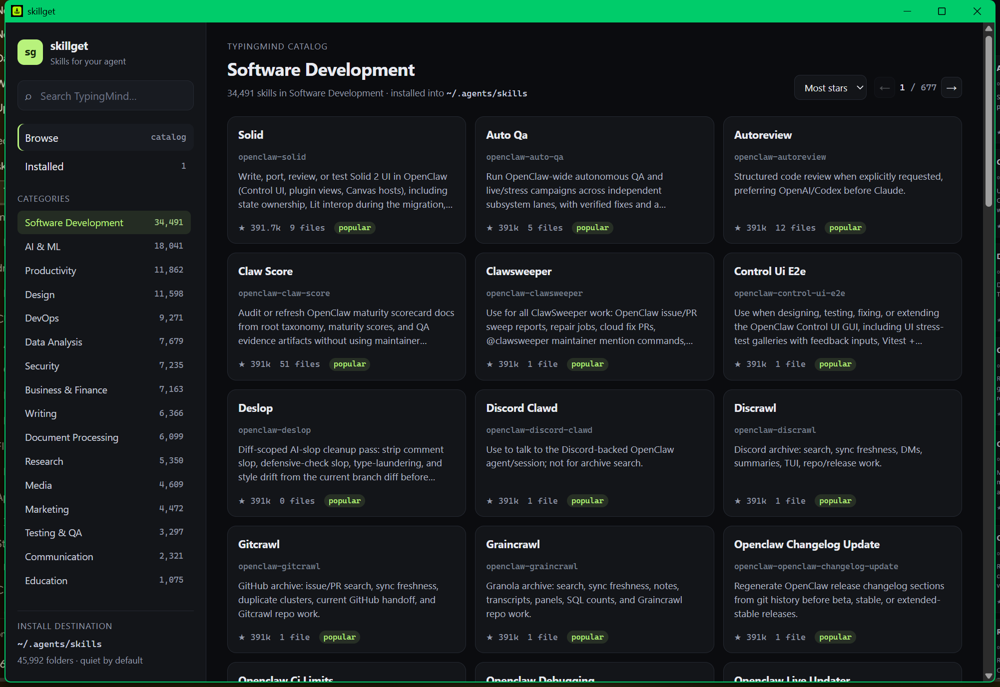
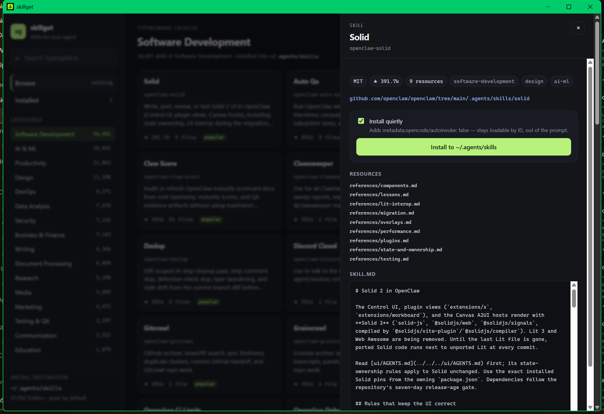
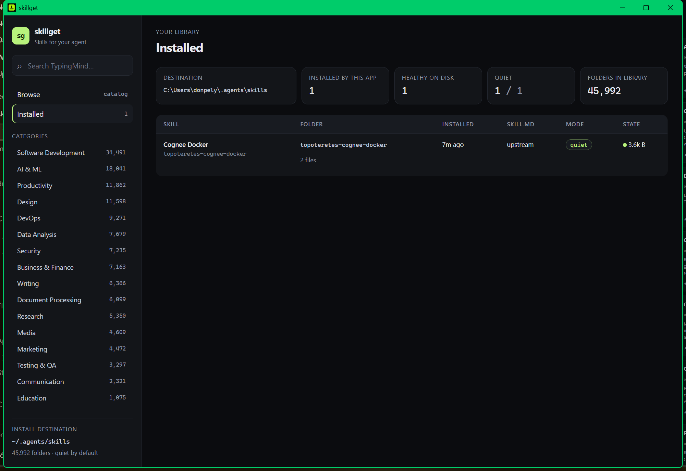

# skillget desktop

A Windows desktop app for the [TypingMind skills directory](https://www.typingmind.com/skills):
browse the categories, search the catalog, read a skill's `SKILL.md`, and install it
into `~/.agents/skills` in one click.

The app is a Tauri 2 shell around the same engine as the `skillget` CLI: it fetches the
site's structured catalog data, pulls the upstream `SKILL.md` (and its resources) from
GitHub, and writes an atomic skill folder with provenance.



## What it does

| Screen | What you get |
| --- | --- |
| **Browse** | TypingMind's 16 categories with live skill counts, 51 skills per page, sort by stars or newest, one-click install from a card. |
| **Search** | Site-wide catalog search (TypingMind's own index), paginated, same cards. |
| **Detail** | Source link, license, categories, resource list and a `SKILL.md` preview, plus install/reinstall with a quiet toggle. |
| **Installed** | What this app installed into your skills directory: folder, `SKILL.md` source (`upstream` or `synthesized`), quiet mode, on-disk health, timestamps. |





## Install

Two artifacts are attached to the release:

- **`skillget_0.4.0_x64-setup.exe`** — NSIS installer, installs per user with no admin prompt.
- **`skillget-0.4.0-windows-portable.zip`** — unzip anywhere and run `skillget.exe`.

The build is **not code-signed**, so Windows SmartScreen may show "Windows protected
your PC". Choose *More info → Run anyway*. The binaries are reproducible from this
repository with `npm run app:build`.

Requirements on the target machine: Windows 10/11 x64 with the WebView2 runtime
(preinstalled on current Windows; the installer does not bundle it). Node is bundled —
nothing else needs to be installed.

## Build from source

Prerequisites: Node 20+, Rust (stable) with the MSVC toolchain, and the WebView2 runtime.

```powershell
cd skillget-desktop
npm install
npm run app:build      # vite build -> stage Node sidecar -> tauri build
npm run app:portable   # optional: portable folder + zip under src-tauri/target/portable
```

Outputs:

- `src-tauri/target/release/skillget.exe`
- `src-tauri/target/release/bundle/nsis/skillget_0.4.0_x64-setup.exe`
- `src-tauri/target/portable/skillget-0.4.0-windows-portable.zip`

For UI-only development in a browser:

```powershell
npm run dev            # http://127.0.0.1:5179 (Vite middleware + API in one process)
```

## How it works

```
┌─ skillget.exe (Tauri 2) ─────────────────────────────┐
│  picks a free loopback port, spawns the sidecar,      │
│  polls /api/health, then opens the window on it       │
│                                                       │
│  resources/node.exe  +  resources/server/  +  frontend/ │
└───────────────────────────────────────────────────────┘
                 │  HTTP on 127.0.0.1
                 ▼
       Node engine (server/index.mjs)
       catalog.mjs · github.mjs · installer.mjs · quiet.mjs · manifest.mjs
                 │
                 ▼
   TypingMind page-data endpoints + raw.githubusercontent.com
                 │
                 ▼
        ~/.agents/skills/<folder>/  (SKILL.md, resources, .skillget.json)
```

- The Rust side only picks a port, starts the engine, waits for it, and kills it on exit.
- The engine is the same code path as the CLI, ported to ESM: `safePart`/`cleanRelPath`
  traversal guards, Windows-reserved names, atomic temp-dir install.
- Install state lives in `%LOCALAPPDATA%\com.yourbossdonpely.skillget\state\manifest.json`,
  separate from the CLI's `data/manifest.json`.
- The chosen port is written to `state\port` for diagnostics.

### Install rules

- **Quiet by default.** Installs get `metadata.opencode/autoinvoke: false` so the skill
  stays out of the auto-injected prompt while remaining loadable by ID. The rewrite is
  line-based and only written when the result still parses as YAML.
- **Never overwrite.** A folder the app did not install is left untouched; a collision
  installs as `<slug>-tm`, then `<slug>-tm-2`.
- **Reinstall is in place.** If the app owns the folder (matching slug in
  `.skillget.json`), it is replaced atomically instead of duplicated.
- **Provenance.** Every folder gets `.skillget.json` with slug, source, license,
  categories, install time and resource failures.

### API

| Route | Purpose |
| --- | --- |
| `GET /api/health` | destination, buildId, library folder count, tracked installs |
| `GET /api/categories` | 16 categories with live totals |
| `GET /api/browse?category=&page=&sort=` | one catalog page |
| `GET /api/search?q=&page=&sort=` | site search |
| `GET /api/skill/:slug` | detail payload + install status |
| `POST /api/install` | `{slug, quiet}` → install result |
| `GET /api/installed` | tracked installs with on-disk checks |

## Limitations

- Windows x64 only in this release; the same `tauri build` works for macOS/Linux from
  those hosts.
- Search is TypingMind's catalog only — no GitHub-wide `filename:SKILL.md` search.
- The catalog `buildId` is discovered from the site and cached for 15 minutes; a rotated
  build is retried once with a fresh id.
- The executable is unsigned.
